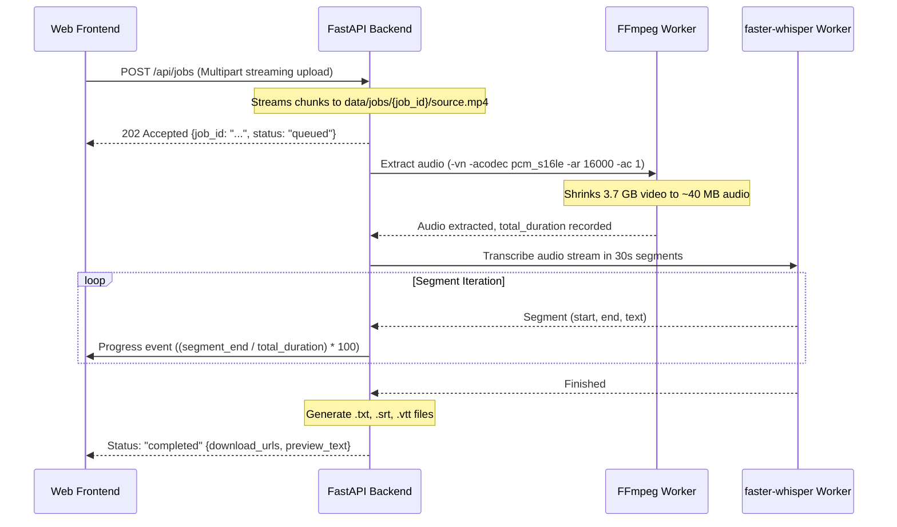

# Video & Audio Transcription Microservice Design

**Date**: 2026-11-14  
**Status**: Validated  
**Goal**: Build a local REST API microservice with an embedded web frontend supporting drag-and-drop to transcribe video and audio files into text transcripts (.txt for Google NotebookLM) and subtitles (.srt, .vtt) with timestamps.

---

## 1. Context & Objectives

* **Primary Use Case**: Transcribing large (up to ~3.7 GB+) `.mp4` recordings of academic lectures and presentations to feed into [Google NotebookLM](https://notebook.google.com).
* **Hardware Profile**:
  * CPU: Intel Core i7-8809G (4 physical cores, 8 logical threads @ 3.10 GHz).
  * RAM: 64 GB physical memory (~48 GB free).
  * GPU: No NVIDIA CUDA GPU (CPU INT8 inference).
  * Storage: 110 GB free on local C: drive.
* **Key Targets**:
  * Fast local execution without paid cloud APIs.
  * Direct streaming upload of multi-gigabyte video files without loading them entirely into memory.
  * Real-time progress updates in the web UI.
  * Formatted output: clean `.txt` for NotebookLM, plus `.srt` and `.vtt` subtitle formats.

---

## 2. Architecture & Tech Stack

```mermaid
flowchart LR
    Browser["Web Browser (Drag & Drop UI)"]
    FastAPI["FastAPI App (REST Endpoints + Static UI)"]
    Queue["Async Job Queue (ThreadPoolExecutor)"]
    FFmpeg["FFmpeg Audio Extractor"]
    Whisper["faster-whisper Engine (INT8 CPU)"]
    Storage["Scratch Storage (data/jobs/{job_id}/)"]

    Browser -->|Stream Upload & Poll/SSE| FastAPI
    FastAPI -->|Enqueue Task| Queue
    Queue -->|Extract 16kHz Mono Audio| FFmpeg
    FFmpeg -->|Feed Audio| Whisper
    Whisper -->|Save .txt, .srt, .vtt| Storage
    Storage -->|Preview & Download| FastAPI
```

* **Backend**: Python 3.11 with **FastAPI** and **uvicorn**. Handles async requests, streaming file uploads, and hosts the static single-page application.
* **Transcription Engine**: **`faster-whisper`** (CTranslate2).
  * Computation type: `int8` (optimized for CPU execution).
  * CPU thread allocation: 6 worker threads (leaving 2 threads free for system responsiveness).
  * Supported models: `base`, `small` (recommended default for academic terminology and speed), `medium`, `large-v3`.
* **Audio Extraction**: **FFmpeg** invoked via subprocess to isolate the audio stream (`16 kHz`, mono, PCM WAV) from video containers (`.mp4`, `.mkv`, `.mov`, `.avi`, `.webm`) and compressed audio files.
* **Frontend**: Embedded single-page application (HTML5, Tailwind CSS, vanilla JS) served directly by FastAPI. Zero Node.js build step required.

---

## 3. Upload & Processing Pipeline

1. **Chunked Streaming**: Uploaded files stream directly to disk under `data/jobs/{job_id}/source.<ext>` in 1 MB chunks to prevent RAM bloat.
2. **Audio Stripping**: FFmpeg strips the video stream and converts the audio track into a 16 kHz mono WAV file, reducing file size by ~98%.
3. **Progress Calculation**: Total audio duration is probed during extraction. As segments are transcribed, progress is updated in real time:
   $$\text{Progress \%} = \min\left(100, \frac{\text{segment\_end\_sec}}{\text{total\_duration\_sec}} \times 100\right)$$
4. **Pruning & Cleanup**: Once audio extraction is complete, the original large raw video file can be pruned to save disk space, retaining only the audio and generated text files.

---

## 4. API Specification

| Method | Endpoint | Description |
| :--- | :--- | :--- |
| `POST` | `/api/jobs` | Upload video/audio file with parameters (`model_size`, `language`, `initial_prompt`). Returns `{job_id, status}`. |
| `GET` | `/api/jobs/{job_id}` | Retrieve job status, progress %, elapsed time, and error details (if any). |
| `GET` | `/api/jobs/{job_id}/events` | Server-Sent Events (SSE) stream pushing live status and progress updates. |
| `GET` | `/api/jobs/{job_id}/download/{format}` | Download result file (`txt`, `srt`, `vtt`). |
| `GET` | `/api/jobs/{job_id}/preview` | Returns initial transcript text for previewing in the UI. |
| `DELETE` | `/api/jobs/{job_id}` | Deletes job directory and temporary files. |

---

## 5. Web Frontend Experience

* **Drag-and-Drop Uploader**: Clean drop target accepting common audio/video formats with file size display.
* **Model Selector**: Dropdown options:
  * `base` (~6-8× speed, ~25 min for 3h audio)
  * `small` (Recommended default: ~2.5-4× speed, ~50 min for 3h audio)
  * `medium` (~1× speed, high precision)
* **Academic Terminology Prompt**: Optional text box to input technical acronyms, speaker names, or jargon to steer Whisper's spelling.
* **Live Progress Bar**: Visual progress bar showing phase ("Extracting audio", "Transcribing: 45% (01:21:00 / 03:00:00)").
* **Results Panel**:
  * **"Copy for NotebookLM"** button (copies plain text directly to clipboard).
  * **"Download .txt"**, **"Download .srt"**, and **"Download .vtt"** buttons.
  * In-browser scrollable transcript viewer with timestamps.

---

## 6. Error Handling & Resource Management

* **Audio Stream Validation**: FFmpeg inspects source files before transcription. If no audio stream is present, the job fails gracefully with an informative error.
* **CPU Core Allocation**: Execution is capped at 6 worker threads to ensure the OS and web UI remain fully responsive.
* **Automatic Storage Pruning**: Optional auto-prune flag to delete source video files immediately following audio extraction.
* **Automatic Model Weight Caching**: Models are downloaded on first use to a local cache directory (`models/`) with status reported in the UI.

---

## 7. Testing Strategy

* **Unit Tests**:
  * Subtitle formatting (`.srt`, `.vtt`, `.txt`) from mock segment tuples.
  * FFmpeg audio extraction command generation and execution.
* **API Integration Tests**:
  * FastAPI `TestClient` tests covering upload, job creation, status polling, and file downloads.
* **End-to-End Verification**:
  * Automated test running a synthetic 2-second audio file through the local `faster-whisper` INT8 pipeline.
